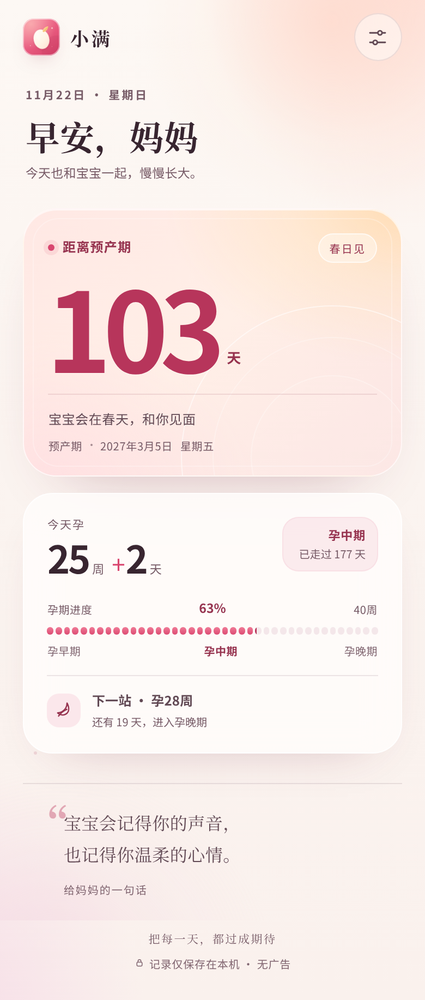
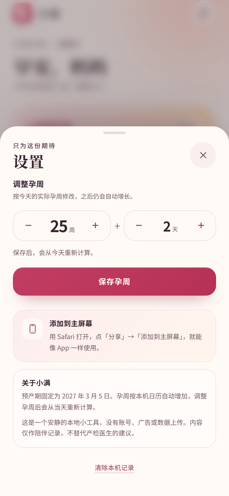
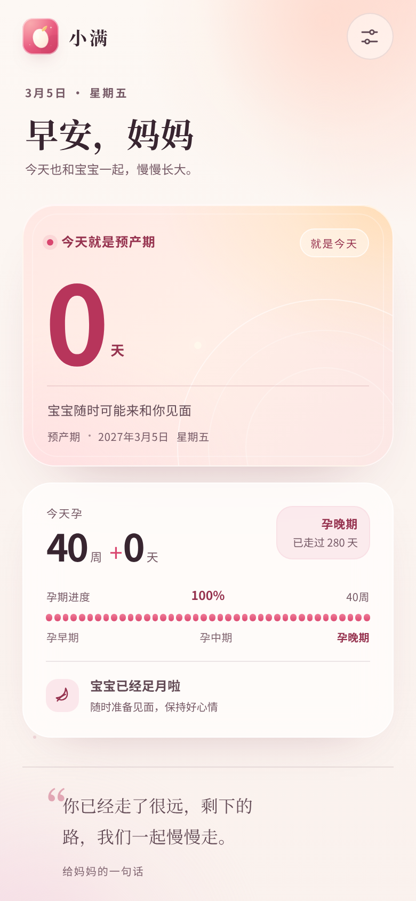
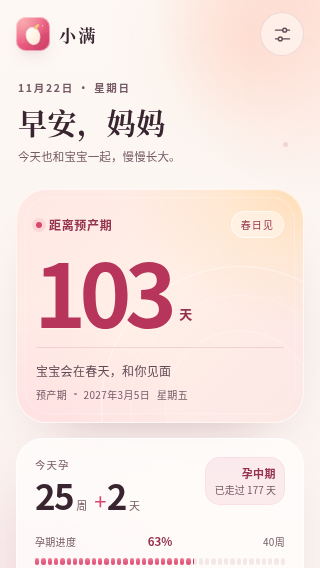

# 小满 · 自我审计报告

- 审计日期：2026-11-22
- 版本：1.0.0
- 目标设备：iPhone / iOS Safari，主屏 PWA
- 固定预产期：2027-03-05（星期五）
- 当前示例日期：2026-11-22，对应孕 25 周 + 2 天、距预产期 103 天

## 一、结论

核心功能、离线能力、视觉呈现和基础无障碍均已按目标完成。最后一轮自动化结果：

| 项目 | 结果 |
| --- | --- |
| 日期内核单元测试 | 13 / 13 通过（UTC、Asia/Shanghai、America/New_York、Pacific/Kiritimati 四时区均通过） |
| 静态工程检查 | 42 / 42 通过 |
| 浏览器端交互检查 | 52 / 52 通过 |
| 浏览器控制台错误 | 0 |
| axe 无障碍扫描 | 首次设置、主页、设置抽屉均为 0 violations（WCAG 2.2 A/AA + best-practice） |
| 离线冷启动 | 在线打开并安装 Service Worker 后，断网重开仍可显示主页和正确倒计时 |
| 320px 小屏横向溢出 | 无 |

**尚未完成的外部步骤：** 项目还没有部署到公网 HTTPS 地址，因此目前不能直接在一台新的 iPhone 上“添加到主屏幕”。代码与安装所需的 manifest、图标、启动图、Service Worker 已齐备，部署后即可安装。真机 Safari 的视觉和 VoiceOver 手感仍建议在送出前做一次人工验收。

## 二、主要交付结果

### 功能

- 首次打开自动按预产期预填孕周（示例日期为 25 周 + 2 天），也支持直接输入或步进调整。
- 保存后使用“校准日 + 已过自然日”的模型递增孕周，明天打开会从 25+2 变成 25+3，倒计时从 103 变成 102。
- 固定预产期 2027-03-05，倒计时、孕周、孕期进度三者独立且可解释。
- 覆盖预产期当天（0 天、40 周、100%）和超期（显示超期 3 天、标签切换为“静候佳音”）的状态。
- 设置中可以重新校准、查看添加到主屏幕说明、清除本机记录。
- 所有数据只写入本机 `localStorage`，没有账号、统计、广告或外部请求。

### PWA / iPhone

- manifest 完整：standalone、竖屏、主题色、192/512 图标、maskable 图标。
- 180px 不透明 Apple Touch Icon。
- 12 张常见 iPhone 尺寸的启动图，减少主屏冷启动白屏。
- 支持安全区、主屏标题、iOS 状态栏声明、离线缓存和版本清理。
- 相对路径部署，支持站点根目录或子目录。

### 视觉

- 使用奶油米白、低饱和柚子粉、杏色的暖色系统；文字使用深梅子色而非纯黑，呼应美柚的女性向柔和基调，但未直接复刻其界面。
- 标题用宋体拉开气质，数据与操作使用系统无衬线 / 圆体字；同一页面内“诗意”和“信息”分工明确。
- 主页信息层级为：问候 → 倒计时 → 当前孕周与进度 → 下一站 → 每日一句，首屏能看到最核心的倒计时和孕周。
- 40 格进度条不仅表达百分比，也保留“这一周还没走完”的部分填充细节。
- 卡片、输入框、底部抽屉统一 27–31px 圆角；背景光和投影克制，不使用高饱和渐变堆叠。

### 体验

- 首次进入无需阅读说明即可完成设置；已按时按预产期填好 25+2，点击“开始数日子”即可。
- 步进按钮和数字输入同时可用；非法孕天（7 天以上）会就地提示，不会进入主页。
- 设置修改后立即反馈“孕周已更新”，并重新锚定当天。
- 主页面无多余导航；设置入口固定、轻量，不干扰倒计时。
- 本地记录不随刷新丢失；提供不可逆操作确认；断网不阻断使用。
- 支持 `prefers-reduced-motion`；焦点可见；对话框使用原生 `dialog` 的焦点约束。

## 三、自查中发现并修复的问题

审计不是只截了图，过程中实际修正了这些问题：

1. **预产期前一天就显示 100%**
   - 原因：进度百分比四舍五入，279/280 变成 100%。
   - 修复：改为向下取整；预产期当天才显示 100%。

2. **每日一句话出现“心情”被拆成两行、末行孤字**
   - 修复：为引用段落启用 `text-wrap: balance`，并重新截图确认换行更均匀。

3. **设置抽屉在小屏上可能被截断**
   - 修复：为滚动区增加 `min-height: 0`，短屏改为内部滚动，头部固定。

4. **辅助文字对比度不足**
   - 原色在奶油底上对比度仅约 3:1。
   - 修复：调深辅助色，小字号普遍不低于 4.8:1 的既定颜色关系；同时把 8.5–9px 的微文案提升到 10px 左右。

5. **可点击区域偏窄**
   - 现代 iPhone 宽度下，孕周/孕天步进按钮提升到 44×44；375px 级屏幕为 38×44，320px 级为 34×44。
   - 清除记录这类文字操作补足 44px 高触控区域。
   - axe 曾对孕天输入框报告过 `target-size`，通过重新分配孕周/孕天两列宽度和点击标签关系消除违规。

6. **装饰性光晕造成潜在横向滚动**
   - 修复：给首次设置页设置 `overflow-x: clip`，320px 实测无横向溢出。

7. **主屏冷启动白屏**
   - 增加覆盖常见 iPhone 尺寸的 Apple startup image，并让其中央标识与页面 loading 标识保持同样尺寸和位置。

8. **临近预产期/超期文案状态单一**
   - 增加“就是今天”“静候佳音”标签和对应解释文案，避免过时或不体贴的提示。

## 四、视觉与审美评估

### 做得好的地方

- 主题色系统有明确来源：奶油底 + 柚子粉 + 杏色，整体比常见“满屏粉红”的孕产 App 更克制。
- 大字倒计时、宋体问候与圆润的数字构成温和的视觉锚点，避免了工具型 App 的冷感。
- 各类卡片的层级、留白与阴影一致；首屏不是模块堆砌，而是从“还剩多少天”自然过渡到“宝宝现在多大”。
- 图标是一个奶油色的种子/果实配金色叶片，缩小到主屏尺寸仍可辨认，也没有直接复制美柚商标。
- 设置面板保留与主页一致的字体与色调，不是系统默认的白色表单。

### 仍有审美风险

- 截图使用 Linux 的 Noto Serif CJK，iPhone 实际会使用宋体，字重和字面略有差异；需要在真机确认标题的呼吸感。
- 当前未支持深色模式，系统深色模式下仍会保持浅色品牌界面。对这款产品是有意为之，但需要在真机确认状态栏观感。
- 主屏 PWA 的状态栏颜色最终取决于 iOS 版本，代码使用 `default` 以保证文字可读，无法在所有系统版本上做到完全无缝。
- 启动图只覆盖常见机型；极少见的宽高比机型会退回系统默认启动画面。

## 五、无障碍与细节证据

- 页面语言、标题层级、可访问名称完整。
- 表单错误用 `role="alert"`，输入框通过 `aria-describedby` 关联提示和错误。
- 进度条有 `role="progressbar"`、`aria-valuenow` 和中文 `aria-valuetext`。
- 装饰画、背景光、图标全部对读屏隐藏；正文图片替代文本为空。
- 键盘焦点、原生 dialog 逃逸关闭、减少动态效果偏好的基础支持均存在。
- axe 的 `color-contrast` 有 “incomplete” 项，因为页面使用渐变和半透明卡片，工具无法自动取样；人工按设计色值计算，正文和按钮的关键组合均达到至少 4.5:1，超大倒计时数字远高于大文本 3:1 要求。

原始证据：

- [浏览器审计结果](./audit-results.json)
- [扩展无障碍审计结果](./a11y-extended.json)

## 六、截图

以下截图由 390×844、2 倍像素密度的 Chromium iPhone 模拟环境生成，使用固定时间 2026-11-22 08:30（Asia/Shanghai）以保证可复现。

### 首次设置

### 主页

### 设置抽屉

### 预产期当天

### 320px 小屏

更多截图：`audit/screenshots/`。

## 七、尚未做的和有意不做的

- **未部署到公网 HTTPS。** 这是 iPhone 安装 PWA 的硬前提；没有在未获得托管授权的情况下把私人应用上传到第三方。
- **未在实体 iPhone 上验收。** 当前全部视觉和交互证据来自 Chromium iPhone 模拟；Safari 的字体、状态栏、启动图和主屏行为需要在真机做最后一眼确认。
- **没有做推送提醒。** 这需要后端 Web Push 与通知授权，与“安静、无账号、纯本地”的定位冲突，属于下一阶段可以单独讨论的功能。
- **没有加入产检/体重/胎动记录。** 当前产品刻意只做倒计时与孕周，避免信息焦虑和功能膨胀。
- **不提供医疗结论。** 设置里已注明内容仅作陪伴记录，不替代产检医生建议。
- **数据只在本机。** 清除浏览器数据或卸载站点缓存会丢失记录；UI 中已提供清除入口和提示。
- **孕周与预产期的校准关系：** 预产期固定；修改“今天的孕周”会从修改当天重新计算孕周，不会改变预产期本身。

## 八、送出前验收清单

1. 把整个项目目录部署到 HTTPS 静态托管。
2. 用 iPhone Safari 打开，分享 → 添加到主屏幕。
3. 从主屏幕启动，确认启动图、图标、状态栏、安全区、滚动是否正常。
4. 输入今天的实际孕周和孕天，确认主页数字、进度和预产期一致。
5. 打开飞行模式后从主屏再次启动，确认离线可用。
6. 将手机日期临时改到预产期当天和之后一天，确认“就是今天 / 静候佳音 / 超期天数”状态（看完记得改回）。
7. 如家里长辈或妻子使用 VoiceOver，再走一遍设置与输入流程。

## 九、视觉参考来源

美柚的配色方向参考自公开产品体验与设计分析，最终色板为本文设计系统重新调校，并非逐像素复制：

- [小红书 · 美柚产品体验（2025-11-26）](https://www.xiaohongshu.com/discovery/item/6926fd26000000001b0261e8)
- [以调查问卷方式体验美柚](https://www.e-com-net.com/article/1745027537236410368.htm#1)
- [简书 · 轻分析美柚](https://www.jianshu.com/p/5b3dbf9a74e3#1)
